# Lead Generation & Skip Tracing Samples

Demo portfolio for **Zaid Mubbasher · B2B Lead Generation & Skip Tracing**.

I build targeted B2B lead lists and run real-estate skip tracing for businesses and investors in the US and Canada. I've been doing this work for 5 years. This repository shows what a delivery looks like: 24 B2B lead-list samples and 24 skip-trace and list-building samples. Each one has its own column set, a spreadsheet you can open, and a preview image.

> [!IMPORTANT]
> **All data in this repository is fictional demo data.** Every person, company, street address, phone number and email address is invented. Phone numbers use the reserved `555-01XX` range, emails use `-demo.com` or `example.com/.net/.org` domains, and street names are made up. No real contact data was scraped or used. Each CSV and XLSX file carries a `DEMO SAMPLE · fictional data` note in its first row, and every image carries the same label. Counts such as "Emails verified 48/50" describe the demo file only. They are not accuracy claims.

## What's in each sample folder

| File | What it is |
|---|---|
| `data.csv` | Demo rows (30 to 60). Row 1 is the demo note and row 2 holds the column headers. |
| `data.xlsx` | Same rows in Excel, with frozen headers, filters and a "Read me" sheet |
| `cover.jpg` | 1280×769 preview (gallery size) |
| `cover_square.jpg` | 1200×1200 preview (portfolio tile) |

Two portfolio PDFs sit at the top level: [`Zaid_B2B_Lead_Generation_Portfolio.pdf`](Zaid_B2B_Lead_Generation_Portfolio.pdf) and [`Zaid_Skip_Tracing_Portfolio.pdf`](Zaid_Skip_Tracing_Portfolio.pdf). [`index.json`](index.json) lists every sample with its title, niche, region, row count and file paths.

## B2B lead generation samples

Decision-maker lists with name, title, company, website, business email and its status (Valid or Catch-all), direct and company phones, LinkedIn URL, location and source. The extra columns change with the niche: funding stage, practice type, doors managed, service trucks and so on.

| Preview | Sample | Rows | Files |
|:---:|---|:---:|---|
| 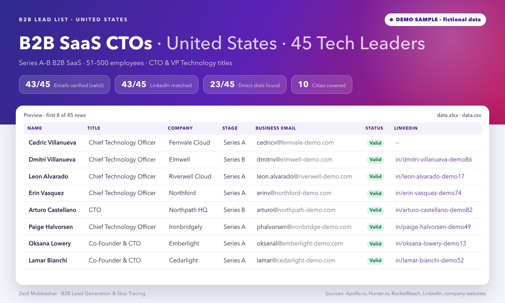 | **B2B SaaS CTOs** United States · 45 Tech Leaders Series A–B B2B SaaS · 51–500 employees · CTO &amp; VP Technology titles | 45 | [CSV](b2b/01-saas-ctos-us/data.csv) · [XLSX](b2b/01-saas-ctos-us/data.xlsx) [square cover](b2b/01-saas-ctos-us/cover_square.jpg) |
| 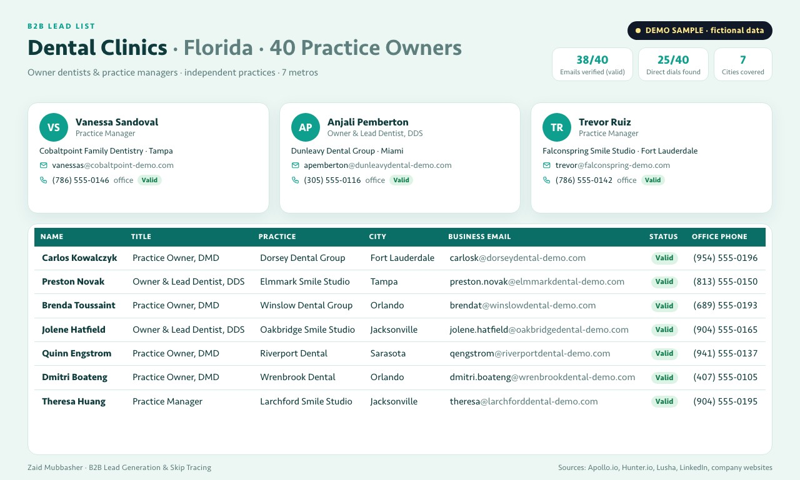 | **Dental Clinics** Florida · 40 Practice Owners Owner dentists &amp; practice managers · independent practices · 7 metros | 40 | [CSV](b2b/02-dental-clinics-florida/data.csv) · [XLSX](b2b/02-dental-clinics-florida/data.xlsx) [square cover](b2b/02-dental-clinics-florida/cover_square.jpg) |
|  | **Personal-Injury Law Firms** Illinois · 36 Managing Partners Managing &amp; founding partners · 2–40 attorneys · Chicago metro + downstate | 36 | [CSV](b2b/03-pi-law-firms-illinois/data.csv) · [XLSX](b2b/03-pi-law-firms-illinois/data.xlsx) [square cover](b2b/03-pi-law-firms-illinois/cover_square.jpg) |
| 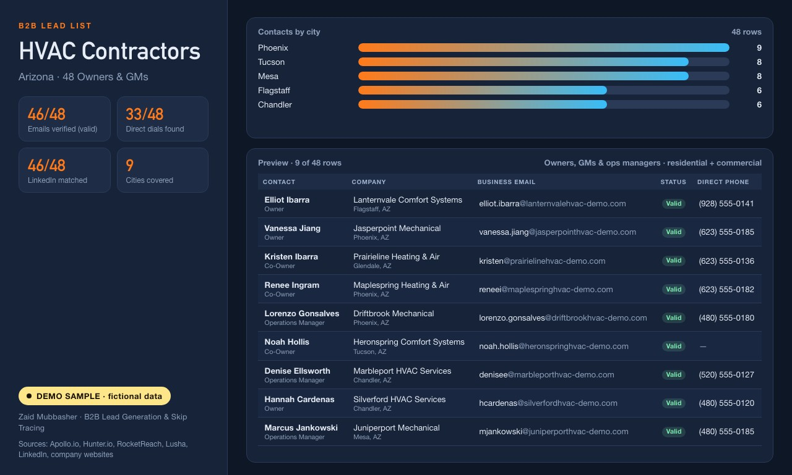 | **HVAC Contractors** Arizona · 48 Owners &amp; GMs Owners, GMs &amp; ops managers · residential + commercial · 3–60 service trucks | 48 | [CSV](b2b/04-hvac-contractors-arizona/data.csv) · [XLSX](b2b/04-hvac-contractors-arizona/data.xlsx) [square cover](b2b/04-hvac-contractors-arizona/cover_square.jpg) |
| 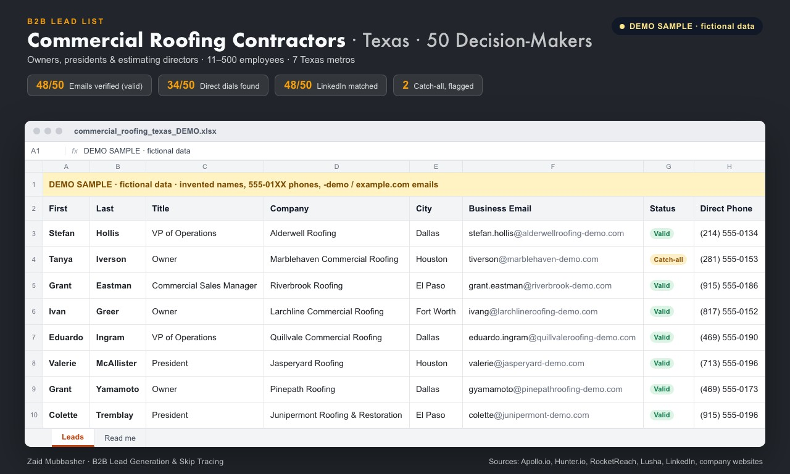 | **Commercial Roofing Contractors** Texas · 50 Decision-Makers Owners, presidents &amp; estimating directors · 11–500 employees · 7 Texas metros | 50 | [CSV](b2b/05-commercial-roofing-texas/data.csv) · [XLSX](b2b/05-commercial-roofing-texas/data.xlsx) [square cover](b2b/05-commercial-roofing-texas/cover_square.jpg) |
| 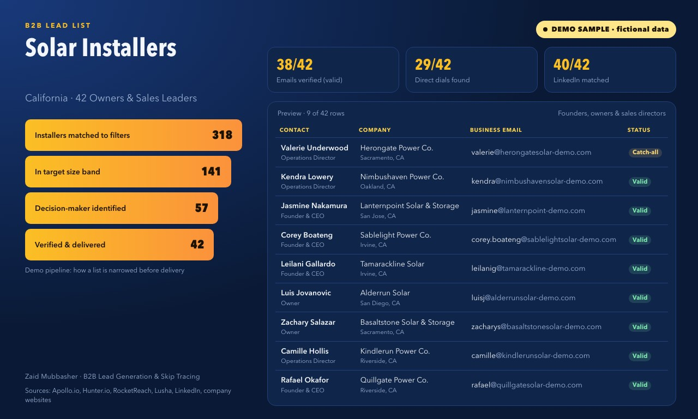 | **Solar Installers** California · 42 Owners &amp; Sales Leaders Founders, owners &amp; sales directors · residential + storage installers | 42 | [CSV](b2b/06-solar-installers-california/data.csv) · [XLSX](b2b/06-solar-installers-california/data.xlsx) [square cover](b2b/06-solar-installers-california/cover_square.jpg) |
| 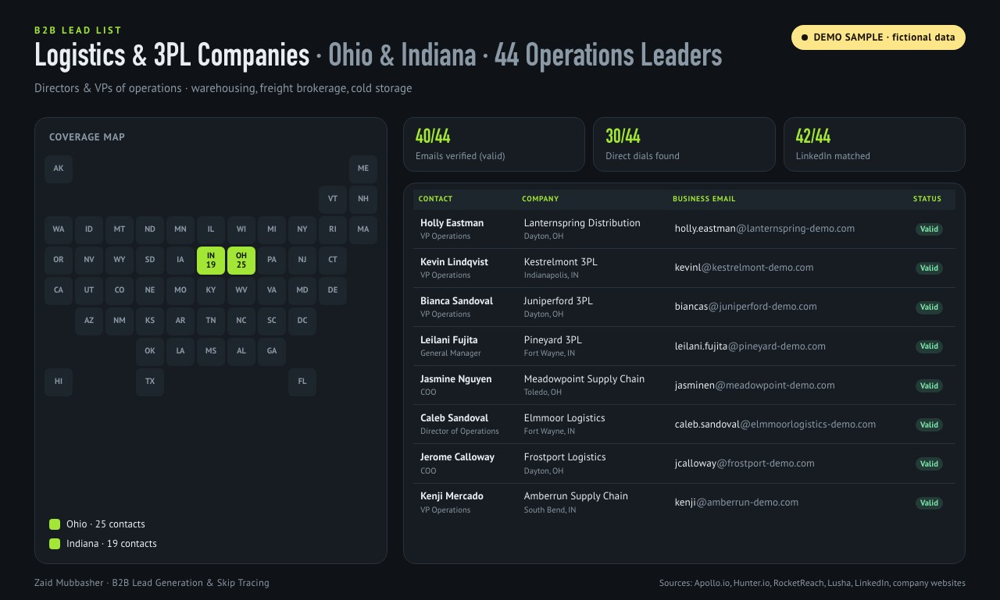 | **Logistics &amp; 3PL Companies** Ohio &amp; Indiana · 44 Operations Leaders Directors &amp; VPs of operations · warehousing, freight brokerage, cold storage | 44 | [CSV](b2b/07-logistics-3pl-ohio-indiana/data.csv) · [XLSX](b2b/07-logistics-3pl-ohio-indiana/data.xlsx) [square cover](b2b/07-logistics-3pl-ohio-indiana/cover_square.jpg) |
| 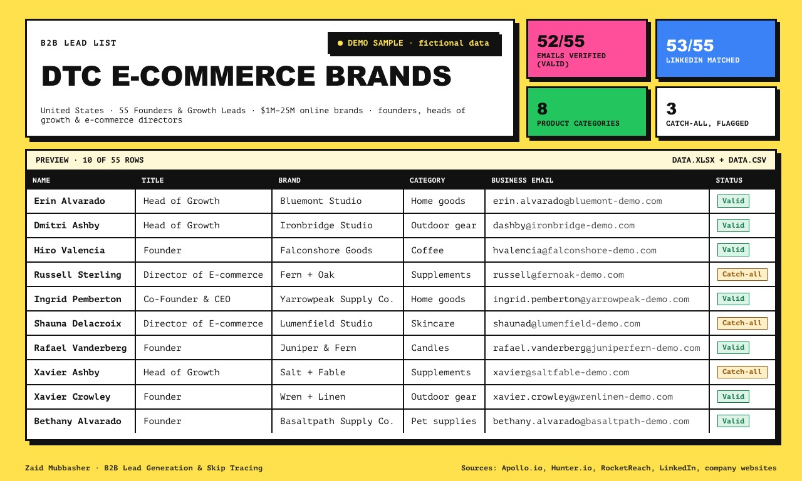 | **DTC E-commerce Brands** United States · 55 Founders &amp; Growth Leads $1M–25M online brands · founders, heads of growth &amp; e-commerce directors | 55 | [CSV](b2b/08-dtc-ecommerce-brands-us/data.csv) · [XLSX](b2b/08-dtc-ecommerce-brands-us/data.xlsx) [square cover](b2b/08-dtc-ecommerce-brands-us/cover_square.jpg) |
|  | **Commercial General Contractors** Georgia &amp; the Carolinas · 45 Decision-Makers Presidents, preconstruction &amp; estimating leads · $10M–100M annual volume | 45 | [CSV](b2b/09-general-contractors-georgia-carolinas/data.csv) · [XLSX](b2b/09-general-contractors-georgia-carolinas/data.xlsx) [square cover](b2b/09-general-contractors-georgia-carolinas/cover_square.jpg) |
| 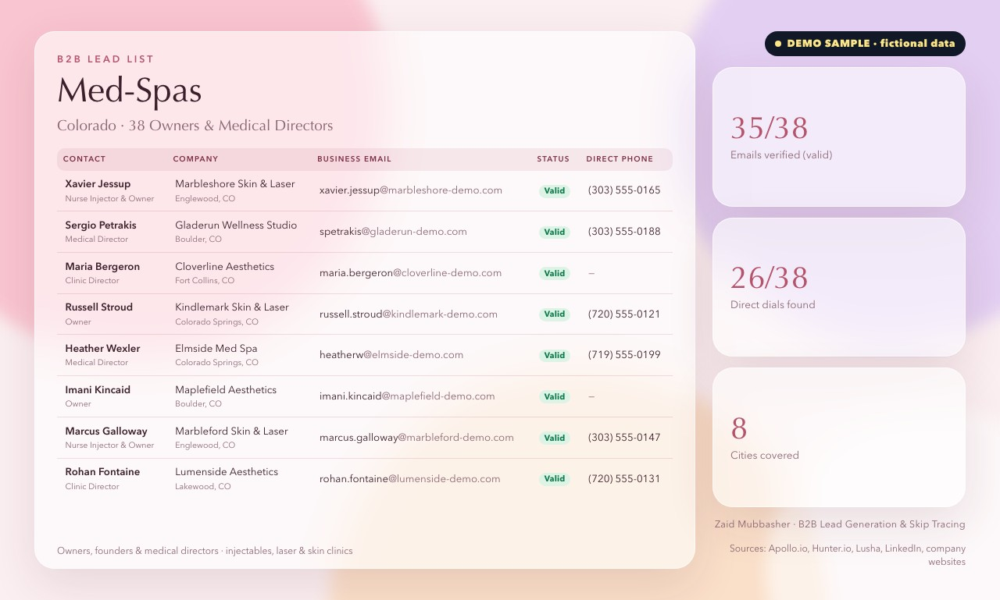 | **Med-Spas** Colorado · 38 Owners &amp; Medical Directors Owners, founders &amp; medical directors · injectables, laser &amp; skin clinics | 38 | [CSV](b2b/10-med-spas-colorado/data.csv) · [XLSX](b2b/10-med-spas-colorado/data.xlsx) [square cover](b2b/10-med-spas-colorado/cover_square.jpg) |
| 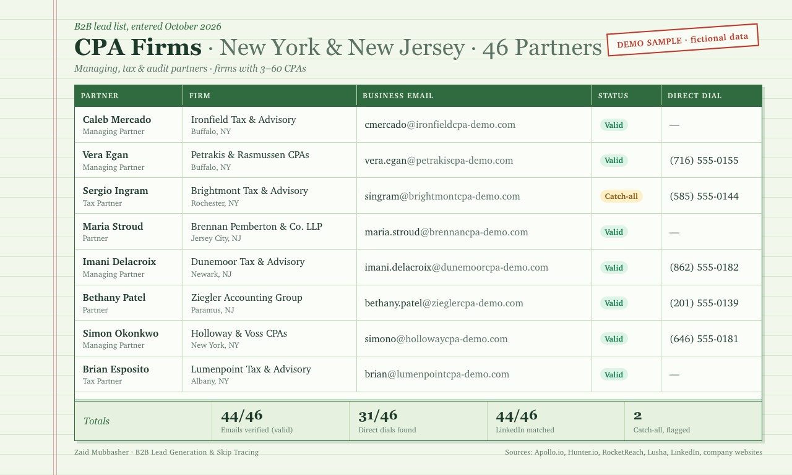 | **CPA Firms** New York &amp; New Jersey · 46 Partners Managing, tax &amp; audit partners · firms with 3–60 CPAs | 46 | [CSV](b2b/11-cpa-firms-new-york-new-jersey/data.csv) · [XLSX](b2b/11-cpa-firms-new-york-new-jersey/data.xlsx) [square cover](b2b/11-cpa-firms-new-york-new-jersey/cover_square.jpg) |
| 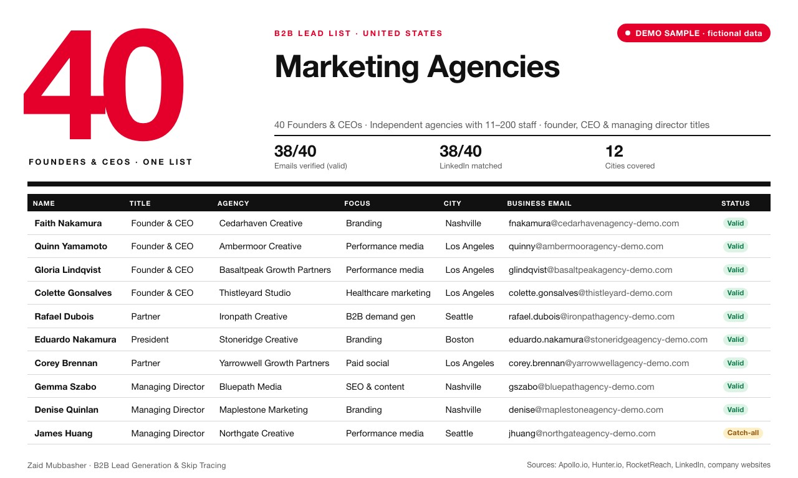 | **Marketing Agencies** United States · 40 Founders &amp; CEOs Independent agencies with 11–200 staff · founder, CEO &amp; managing director titles | 40 | [CSV](b2b/12-marketing-agencies-us/data.csv) · [XLSX](b2b/12-marketing-agencies-us/data.xlsx) [square cover](b2b/12-marketing-agencies-us/cover_square.jpg) |
| 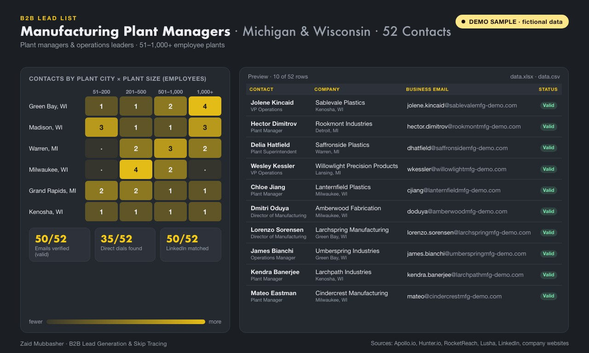 | **Manufacturing Plant Managers** Michigan &amp; Wisconsin · 52 Contacts Plant managers &amp; operations leaders · 51–1,000+ employee plants | 52 | [CSV](b2b/13-plant-managers-michigan-wisconsin/data.csv) · [XLSX](b2b/13-plant-managers-michigan-wisconsin/data.xlsx) [square cover](b2b/13-plant-managers-michigan-wisconsin/cover_square.jpg) |
| 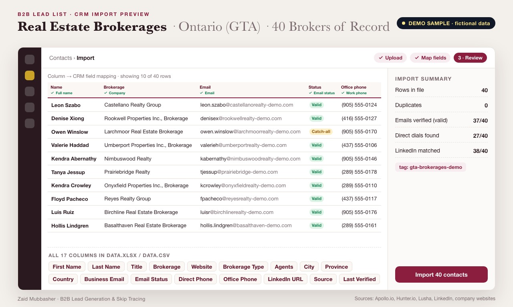 | **Real Estate Brokerages** Ontario (GTA) · 40 Brokers of Record Brokers of record &amp; broker-owners · independent and franchise offices · Canada | 40 | [CSV](b2b/14-real-estate-brokerages-ontario/data.csv) · [XLSX](b2b/14-real-estate-brokerages-ontario/data.xlsx) [square cover](b2b/14-real-estate-brokerages-ontario/cover_square.jpg) |
| 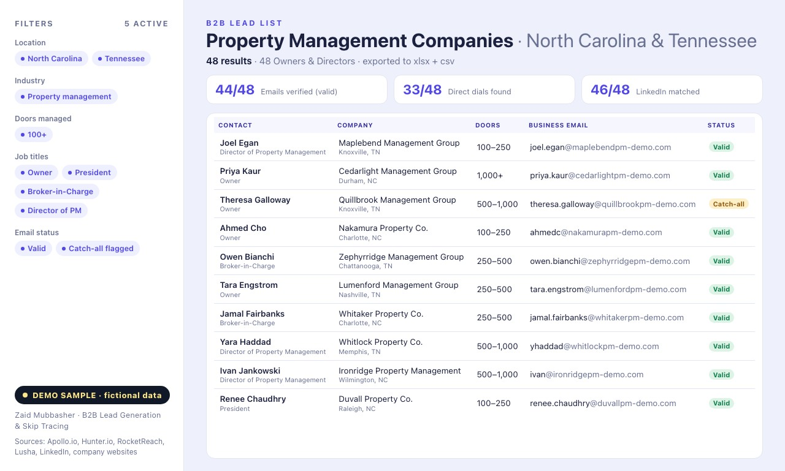 | **Property Management Companies** North Carolina &amp; Tennessee · 48 Owners &amp; Directors Owners, brokers-in-charge &amp; PM directors · 100 to 1,000+ doors | 48 | [CSV](b2b/15-property-managers-nc-tn/data.csv) · [XLSX](b2b/15-property-managers-nc-tn/data.xlsx) [square cover](b2b/15-property-managers-nc-tn/cover_square.jpg) |
| 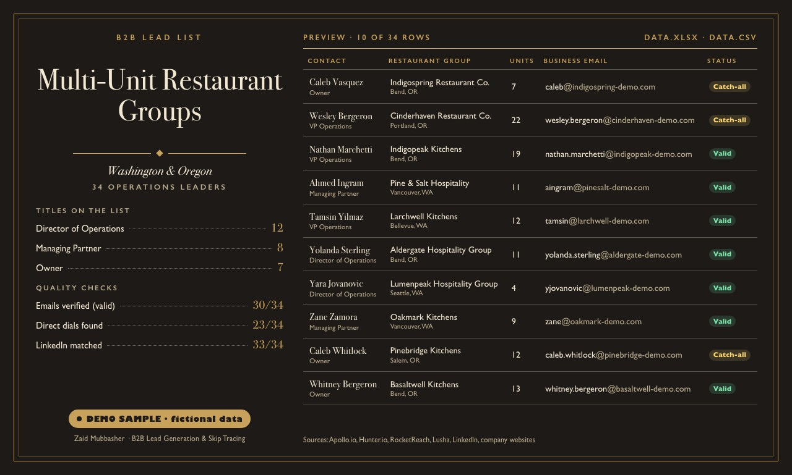 | **Multi-Unit Restaurant Groups** Washington &amp; Oregon · 34 Operations Leaders Groups with 3–24 locations · directors of operations, owners &amp; managing partners | 34 | [CSV](b2b/16-restaurant-groups-washington-oregon/data.csv) · [XLSX](b2b/16-restaurant-groups-washington-oregon/data.xlsx) [square cover](b2b/16-restaurant-groups-washington-oregon/cover_square.jpg) |
| 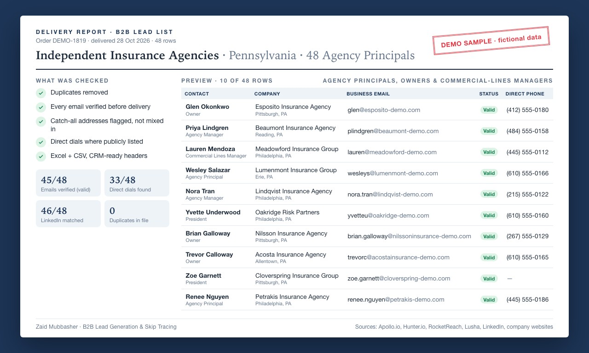 | **Independent Insurance Agencies** Pennsylvania · 48 Agency Principals Agency principals, owners &amp; commercial-lines managers · 2–30 producers | 48 | [CSV](b2b/17-insurance-agencies-pennsylvania/data.csv) · [XLSX](b2b/17-insurance-agencies-pennsylvania/data.xlsx) [square cover](b2b/17-insurance-agencies-pennsylvania/cover_square.jpg) |
| 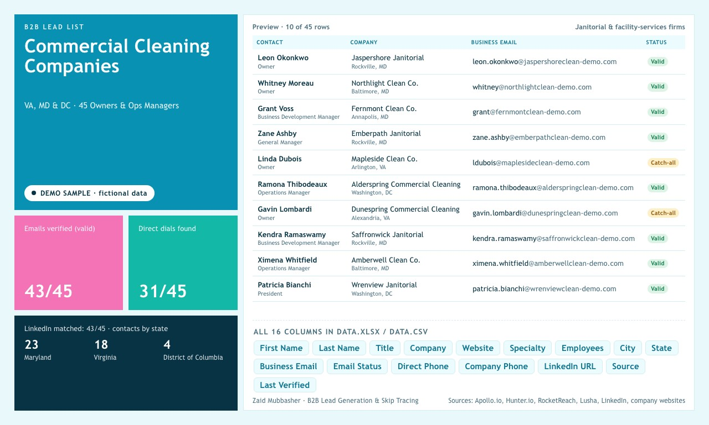 | **Commercial Cleaning Companies** VA, MD &amp; DC · 45 Owners &amp; Ops Managers Janitorial &amp; facility-services firms · owners, presidents &amp; operations managers | 45 | [CSV](b2b/18-commercial-cleaning-va-md-dc/data.csv) · [XLSX](b2b/18-commercial-cleaning-va-md-dc/data.xlsx) [square cover](b2b/18-commercial-cleaning-va-md-dc/cover_square.jpg) |
| 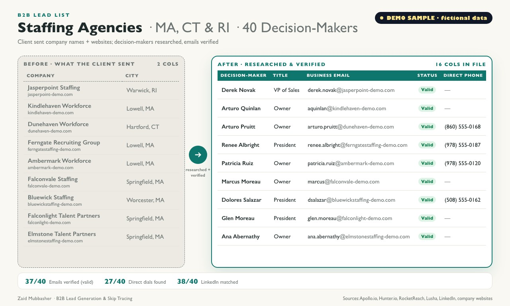 | **Staffing Agencies** MA, CT &amp; RI · 40 Decision-Makers Client sent company names + websites; decision-makers researched, emails verified | 40 | [CSV](b2b/19-staffing-agencies-new-england/data.csv) · [XLSX](b2b/19-staffing-agencies-new-england/data.xlsx) [square cover](b2b/19-staffing-agencies-new-england/cover_square.jpg) |
|  | **Landscaping &amp; Lawn Care** Missouri &amp; Kansas · 50 Owners Owner-operated landscaping, lawn-care &amp; hardscape firms · 2–20 crews | 50 | [CSV](b2b/20-landscaping-companies-missouri-kansas/data.csv) · [XLSX](b2b/20-landscaping-companies-missouri-kansas/data.xlsx) [square cover](b2b/20-landscaping-companies-missouri-kansas/cover_square.jpg) |
| 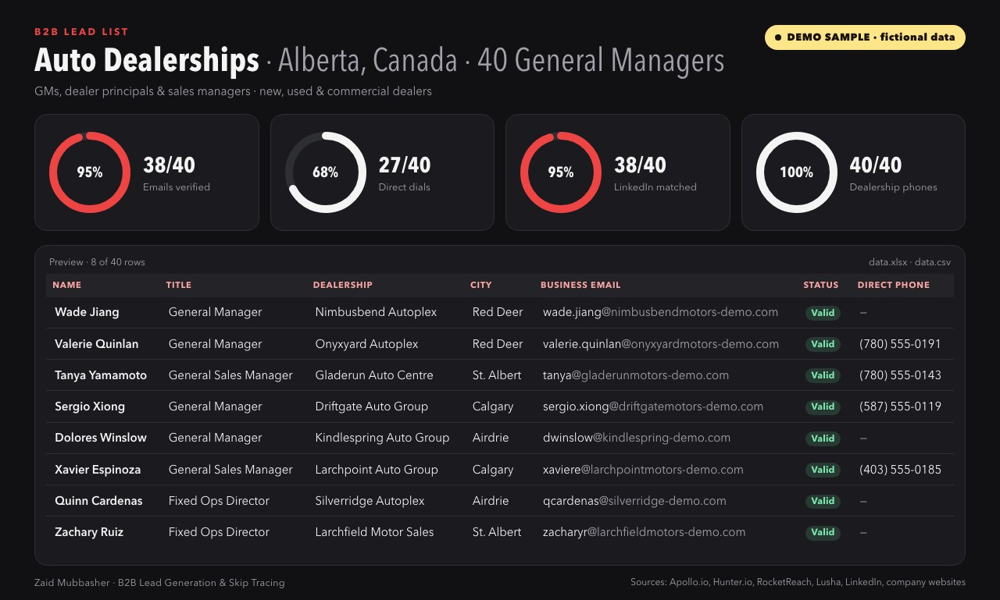 | **Auto Dealerships** Alberta, Canada · 40 General Managers GMs, dealer principals &amp; sales managers · new, used &amp; commercial dealers | 40 | [CSV](b2b/21-auto-dealerships-alberta/data.csv) · [XLSX](b2b/21-auto-dealerships-alberta/data.xlsx) [square cover](b2b/21-auto-dealerships-alberta/cover_square.jpg) |
| 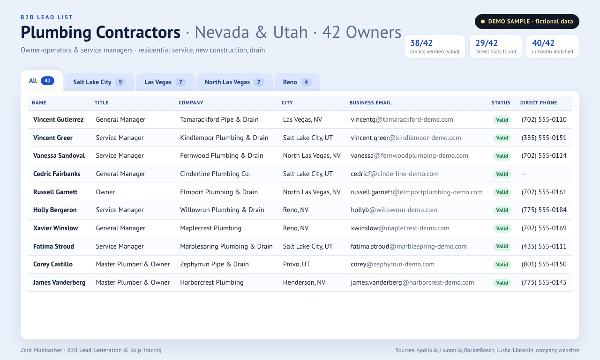 | **Plumbing Contractors** Nevada &amp; Utah · 42 Owners Owner-operators &amp; service managers · residential service, new construction, drain | 42 | [CSV](b2b/22-plumbing-contractors-nevada-utah/data.csv) · [XLSX](b2b/22-plumbing-contractors-nevada-utah/data.xlsx) [square cover](b2b/22-plumbing-contractors-nevada-utah/cover_square.jpg) |
| 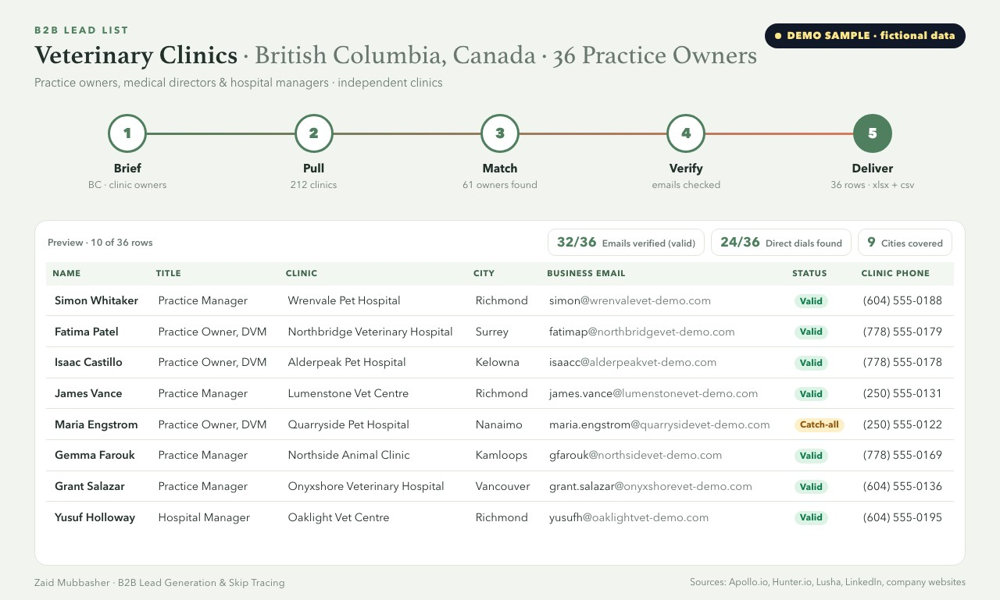 | **Veterinary Clinics** British Columbia, Canada · 36 Practice Owners Practice owners, medical directors &amp; hospital managers · independent clinics | 36 | [CSV](b2b/23-veterinary-clinics-british-columbia/data.csv) · [XLSX](b2b/23-veterinary-clinics-british-columbia/data.xlsx) [square cover](b2b/23-veterinary-clinics-british-columbia/cover_square.jpg) |
| 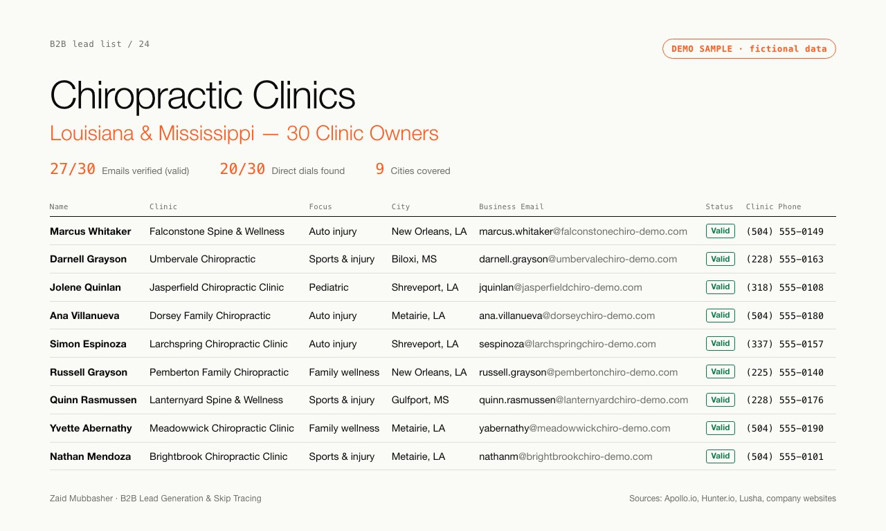 | **Chiropractic Clinics** Louisiana &amp; Mississippi · 30 Clinic Owners Owner chiropractors &amp; clinic directors · 1–6 providers per clinic | 30 | [CSV](b2b/24-chiropractic-clinics-louisiana-mississippi/data.csv) · [XLSX](b2b/24-chiropractic-clinics-louisiana-mississippi/data.xlsx) [square cover](b2b/24-chiropractic-clinics-louisiana-mississippi/cover_square.jpg) |

## Real-estate skip tracing & list building samples

Owner lists for investors and wholesalers. They cover absentee, vacant, pre-foreclosure, tax-delinquent, probate, high-equity, free & clear, code-violation, tired-landlord and stacked lists. Every one is skip-traced for owner phones (Mobile, Landline or VoIP, with status) and emails. Numbers carry a DNC flag where the tool provides one. The set also has entity research (LLC to managing member, trust to trustee), single on-demand lookups, a re-skip of a stale list and a DNC and line-type scrub report.

| Preview | Sample | Rows | Files |
|:---:|---|:---:|---|
| 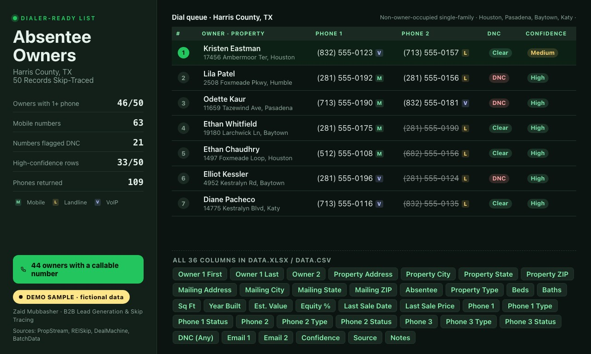 | **Absentee Owners** Harris County, TX · 50 Records Skip-Traced Non-owner-occupied single-family · Houston, Pasadena, Baytown, Katy · bulk skip trace | 50 | [CSV](skiptrace/01-absentee-owners-harris-county-tx/data.csv) · [XLSX](skiptrace/01-absentee-owners-harris-county-tx/data.xlsx) [square cover](skiptrace/01-absentee-owners-harris-county-tx/cover_square.jpg) |
| 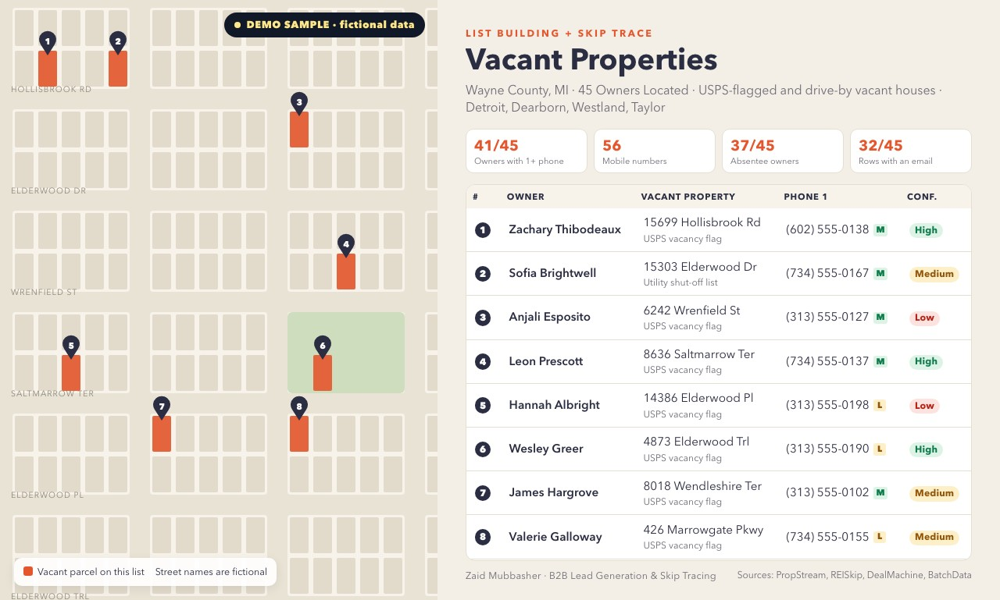 | **Vacant Properties** Wayne County, MI · 45 Owners Located USPS-flagged and drive-by vacant houses · Detroit, Dearborn, Westland, Taylor | 45 | [CSV](skiptrace/02-vacant-properties-wayne-county-mi/data.csv) · [XLSX](skiptrace/02-vacant-properties-wayne-county-mi/data.xlsx) [square cover](skiptrace/02-vacant-properties-wayne-county-mi/cover_square.jpg) |
| 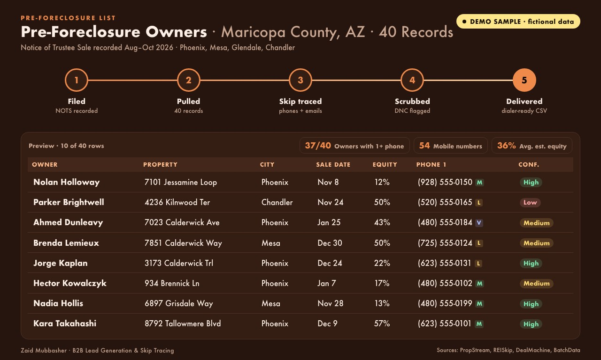 | **Pre-Foreclosure Owners** Maricopa County, AZ · 40 Records Notice of Trustee Sale recorded Aug–Oct 2026 · Phoenix, Mesa, Glendale, Chandler | 40 | [CSV](skiptrace/03-pre-foreclosure-maricopa-county-az/data.csv) · [XLSX](skiptrace/03-pre-foreclosure-maricopa-county-az/data.xlsx) [square cover](skiptrace/03-pre-foreclosure-maricopa-county-az/cover_square.jpg) |
| 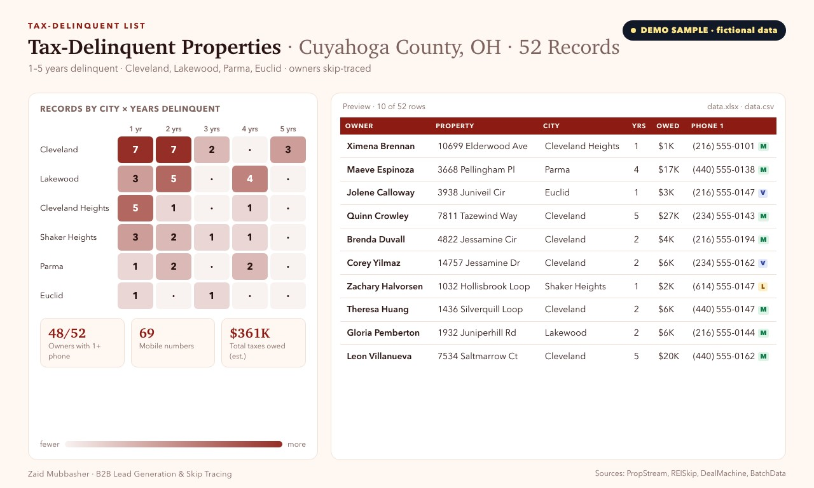 | **Tax-Delinquent Properties** Cuyahoga County, OH · 52 Records 1–5 years delinquent · Cleveland, Lakewood, Parma, Euclid · owners skip-traced | 52 | [CSV](skiptrace/04-tax-delinquent-cuyahoga-county-oh/data.csv) · [XLSX](skiptrace/04-tax-delinquent-cuyahoga-county-oh/data.xlsx) [square cover](skiptrace/04-tax-delinquent-cuyahoga-county-oh/cover_square.jpg) |
| 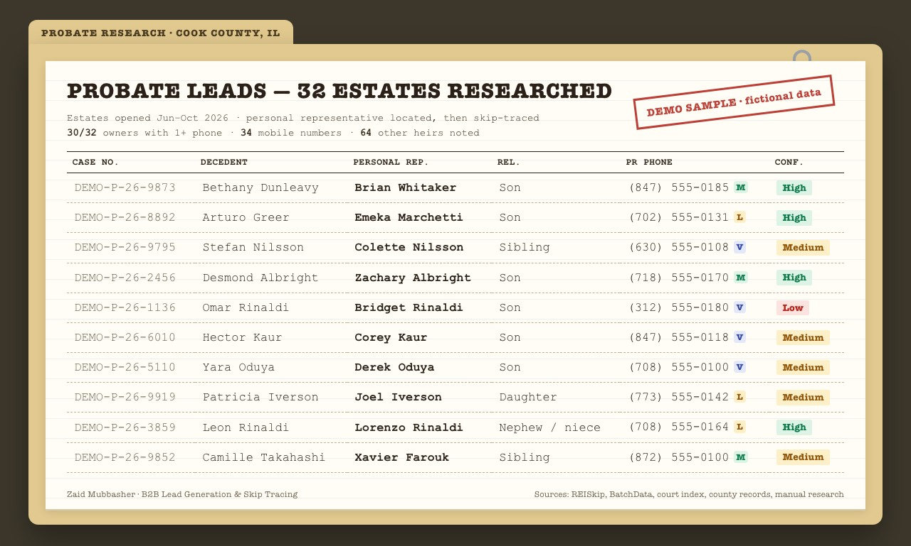 | **Probate Leads** Cook County, IL · 32 Estates Researched Estates opened Jun–Oct 2026 · personal representative located and skip-traced | 32 | [CSV](skiptrace/05-probate-leads-cook-county-il/data.csv) · [XLSX](skiptrace/05-probate-leads-cook-county-il/data.xlsx) [square cover](skiptrace/05-probate-leads-cook-county-il/cover_square.jpg) |
| 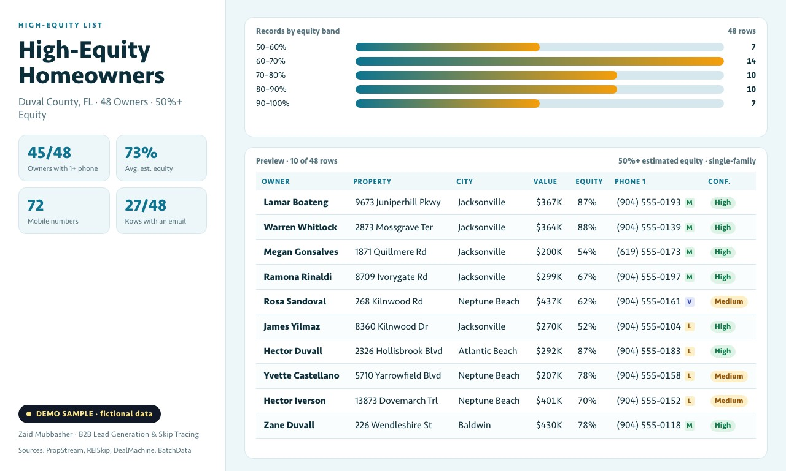 | **High-Equity Homeowners** Duval County, FL · 48 Owners · 50%+ Equity 50%+ estimated equity · single-family · Jacksonville &amp; the beaches | 48 | [CSV](skiptrace/06-high-equity-duval-county-fl/data.csv) · [XLSX](skiptrace/06-high-equity-duval-county-fl/data.xlsx) [square cover](skiptrace/06-high-equity-duval-county-fl/cover_square.jpg) |
| 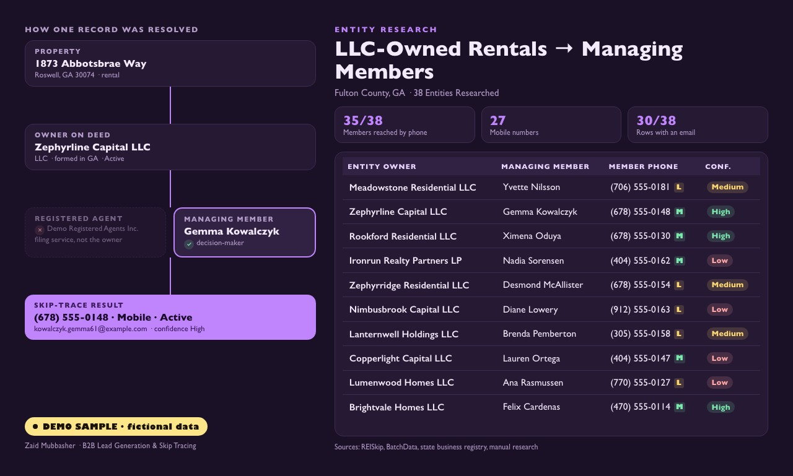 | **LLC-Owned Rentals → Managing Members** Fulton County, GA · 38 Entities Researched Entity owner traced through state filings to the managing member, then skip-traced | 38 | [CSV](skiptrace/07-llc-owned-rentals-fulton-county-ga/data.csv) · [XLSX](skiptrace/07-llc-owned-rentals-fulton-county-ga/data.xlsx) [square cover](skiptrace/07-llc-owned-rentals-fulton-county-ga/cover_square.jpg) |
| 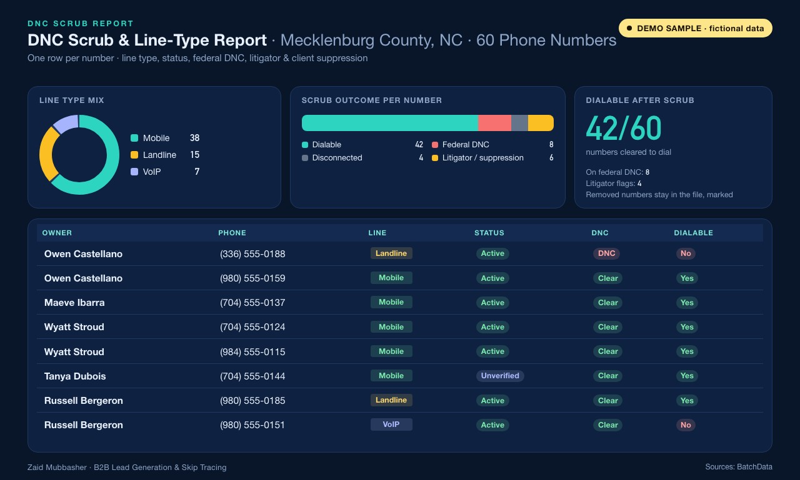 | **DNC Scrub &amp; Line-Type Report** Mecklenburg County, NC · 60 Phone Numbers One row per number · line type, status, federal DNC, litigator &amp; client suppression | 60 | [CSV](skiptrace/08-dnc-scrub-line-type-report-mecklenburg-nc/data.csv) · [XLSX](skiptrace/08-dnc-scrub-line-type-report-mecklenburg-nc/data.xlsx) [square cover](skiptrace/08-dnc-scrub-line-type-report-mecklenburg-nc/cover_square.jpg) |
| 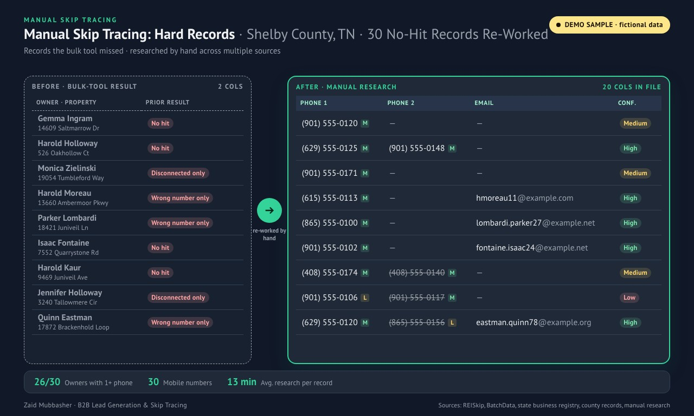 | **Manual Skip Tracing: Hard Records** Shelby County, TN · 30 No-Hit Records Re-Worked Records the bulk tool missed · researched by hand across multiple sources | 30 | [CSV](skiptrace/09-manual-skip-hard-records-shelby-county-tn/data.csv) · [XLSX](skiptrace/09-manual-skip-hard-records-shelby-county-tn/data.xlsx) [square cover](skiptrace/09-manual-skip-hard-records-shelby-county-tn/cover_square.jpg) |
| 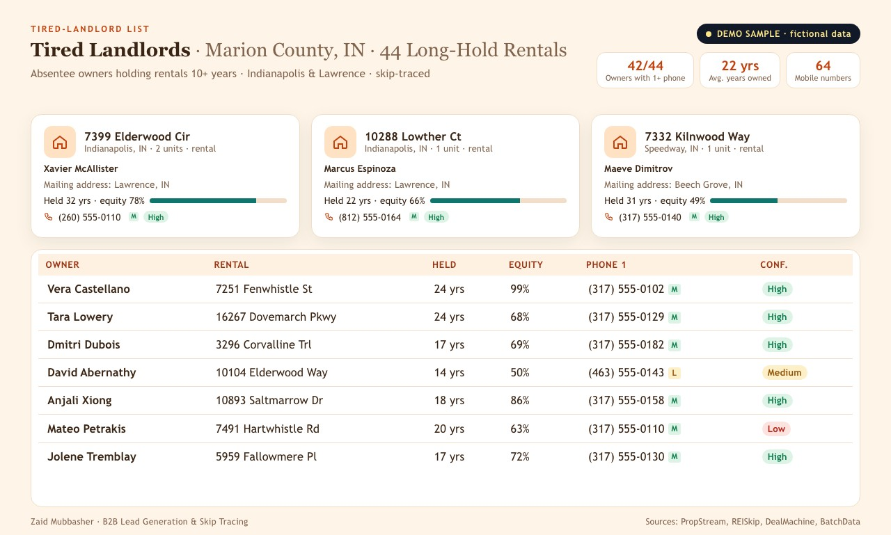 | **Tired Landlords** Marion County, IN · 44 Long-Hold Rentals Absentee owners holding rentals 10+ years · Indianapolis &amp; Lawrence · skip-traced | 44 | [CSV](skiptrace/10-tired-landlords-marion-county-in/data.csv) · [XLSX](skiptrace/10-tired-landlords-marion-county-in/data.xlsx) [square cover](skiptrace/10-tired-landlords-marion-county-in/cover_square.jpg) |
| 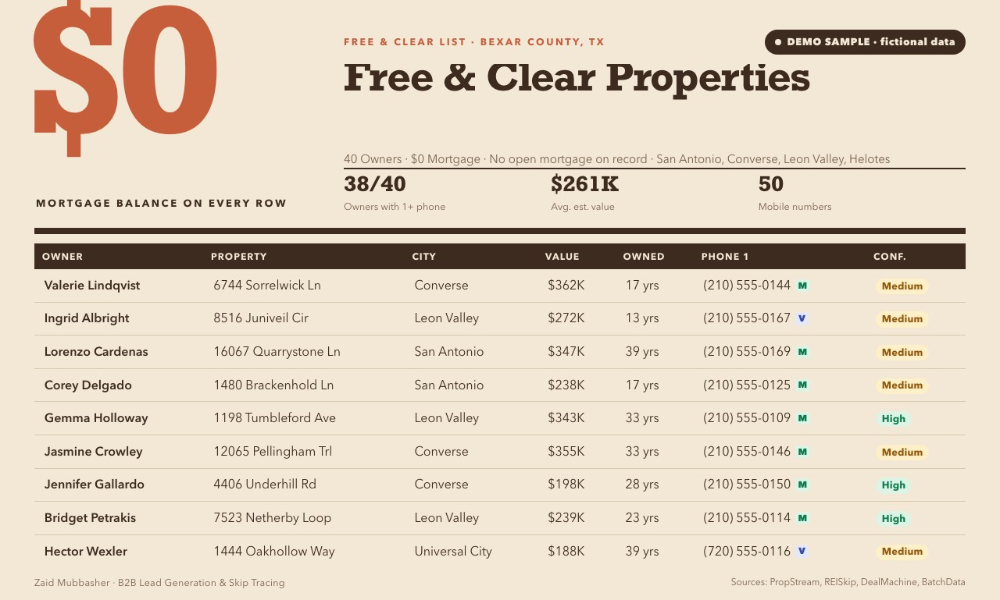 | **Free &amp; Clear Properties** Bexar County, TX · 40 Owners · $0 Mortgage No open mortgage on record · San Antonio, Converse, Leon Valley, Helotes | 40 | [CSV](skiptrace/11-free-and-clear-bexar-county-tx/data.csv) · [XLSX](skiptrace/11-free-and-clear-bexar-county-tx/data.xlsx) [square cover](skiptrace/11-free-and-clear-bexar-county-tx/cover_square.jpg) |
| 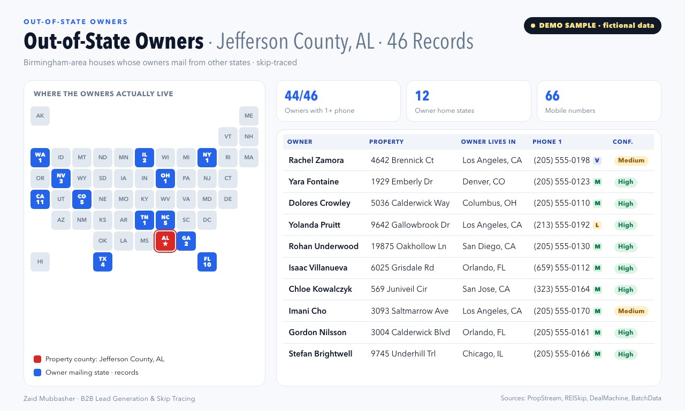 | **Out-of-State Owners** Jefferson County, AL · 46 Records Birmingham-area houses whose owners mail from other states · skip-traced | 46 | [CSV](skiptrace/12-out-of-state-owners-jefferson-county-al/data.csv) · [XLSX](skiptrace/12-out-of-state-owners-jefferson-county-al/data.xlsx) [square cover](skiptrace/12-out-of-state-owners-jefferson-county-al/cover_square.jpg) |
| 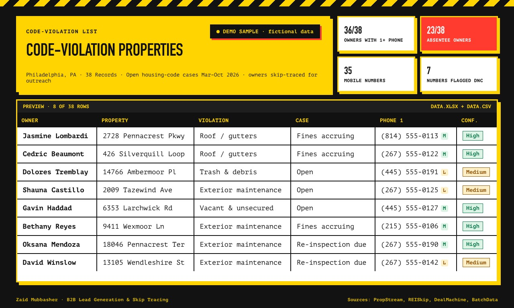 | **Code-Violation Properties** Philadelphia, PA · 38 Records Open housing-code cases Mar–Oct 2026 · owners skip-traced for outreach | 38 | [CSV](skiptrace/13-code-violations-philadelphia-pa/data.csv) · [XLSX](skiptrace/13-code-violations-philadelphia-pa/data.xlsx) [square cover](skiptrace/13-code-violations-philadelphia-pa/cover_square.jpg) |
| 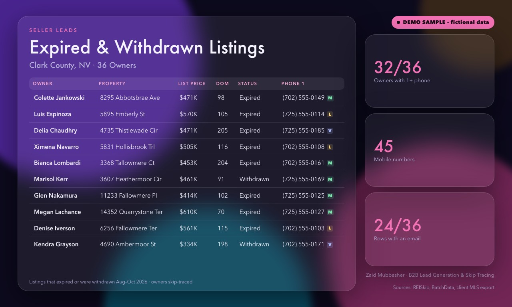 | **Expired &amp; Withdrawn Listings** Clark County, NV · 36 Owners Listings that expired or were withdrawn Aug–Oct 2026 · owners skip-traced | 36 | [CSV](skiptrace/14-expired-listings-clark-county-nv/data.csv) · [XLSX](skiptrace/14-expired-listings-clark-county-nv/data.xlsx) [square cover](skiptrace/14-expired-listings-clark-county-nv/cover_square.jpg) |
| 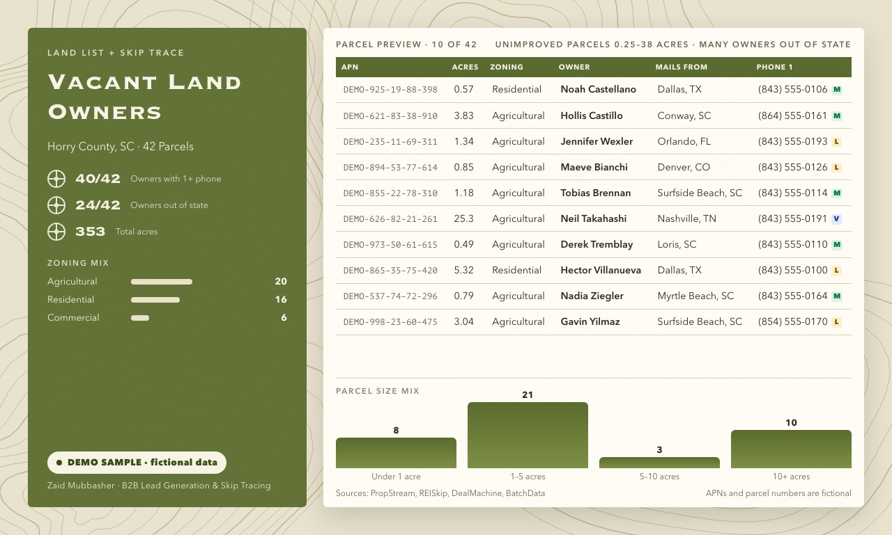 | **Vacant Land Owners** Horry County, SC · 42 Parcels Unimproved parcels 0.25–38 acres · many owners out of state · skip-traced | 42 | [CSV](skiptrace/15-vacant-land-horry-county-sc/data.csv) · [XLSX](skiptrace/15-vacant-land-horry-county-sc/data.xlsx) [square cover](skiptrace/15-vacant-land-horry-county-sc/cover_square.jpg) |
| 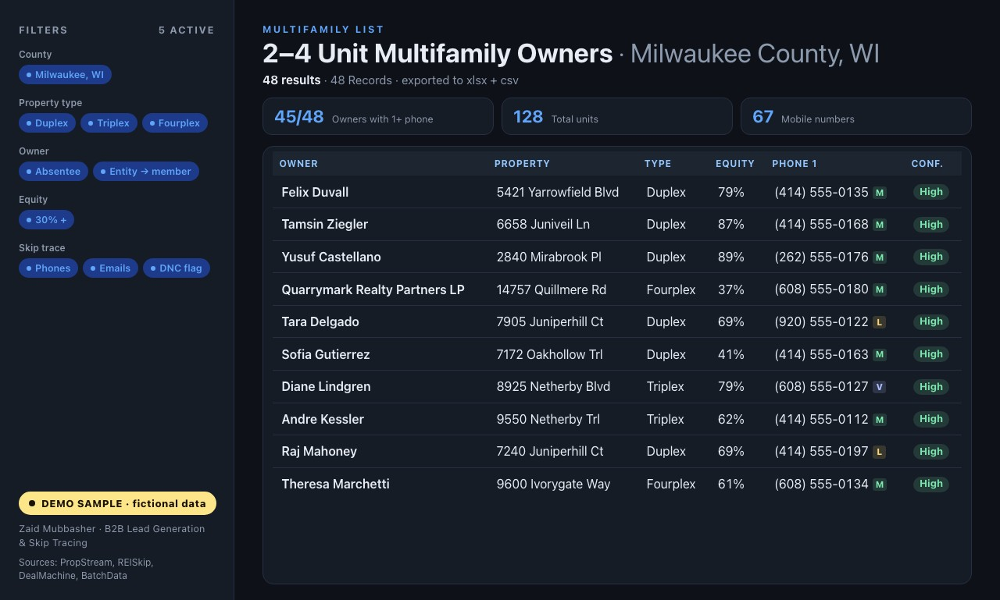 | **2–4 Unit Multifamily Owners** Milwaukee County, WI · 48 Records Duplex, triplex &amp; fourplex owners · absentee · 30%+ equity | 48 | [CSV](skiptrace/16-multifamily-2-4-units-milwaukee-county-wi/data.csv) · [XLSX](skiptrace/16-multifamily-2-4-units-milwaukee-county-wi/data.xlsx) [square cover](skiptrace/16-multifamily-2-4-units-milwaukee-county-wi/cover_square.jpg) |
| 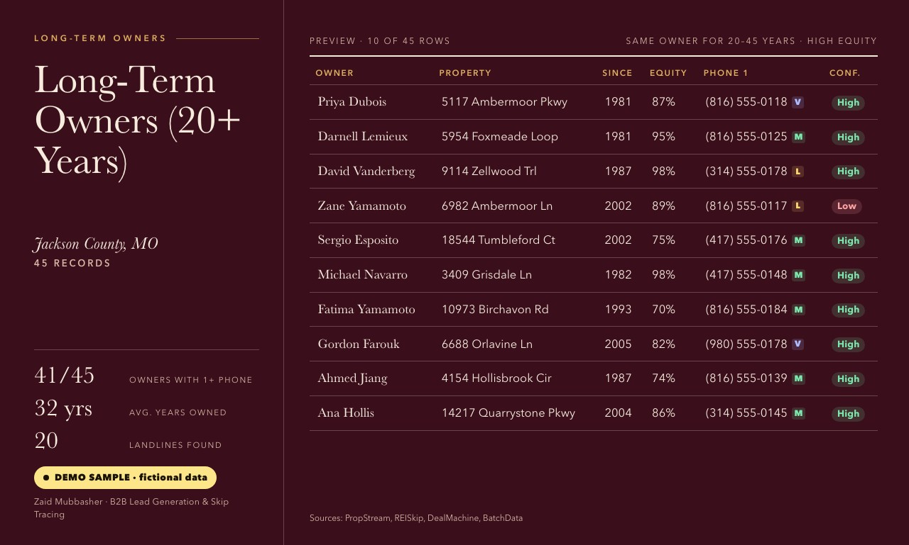 | **Long-Term Owners (20+ Years)** Jackson County, MO · 45 Records Same owner for 20–45 years · high equity · Kansas City, Independence, Raytown | 45 | [CSV](skiptrace/17-long-term-owners-jackson-county-mo/data.csv) · [XLSX](skiptrace/17-long-term-owners-jackson-county-mo/data.xlsx) [square cover](skiptrace/17-long-term-owners-jackson-county-mo/cover_square.jpg) |
| 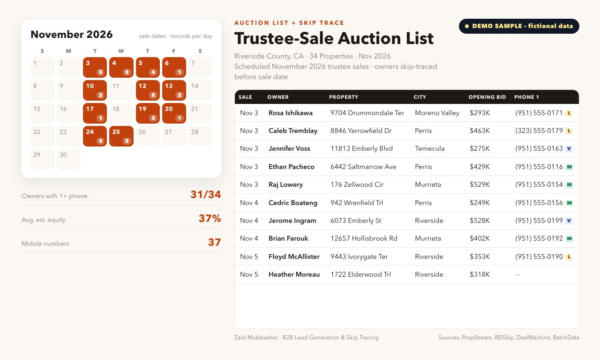 | **Trustee-Sale Auction List** Riverside County, CA · 34 Properties · Nov 2026 Scheduled November 2026 trustee sales · owners skip-traced before sale date | 34 | [CSV](skiptrace/18-trustee-sale-auction-list-riverside-county-ca/data.csv) · [XLSX](skiptrace/18-trustee-sale-auction-list-riverside-county-ca/data.xlsx) [square cover](skiptrace/18-trustee-sale-auction-list-riverside-county-ca/cover_square.jpg) |
| 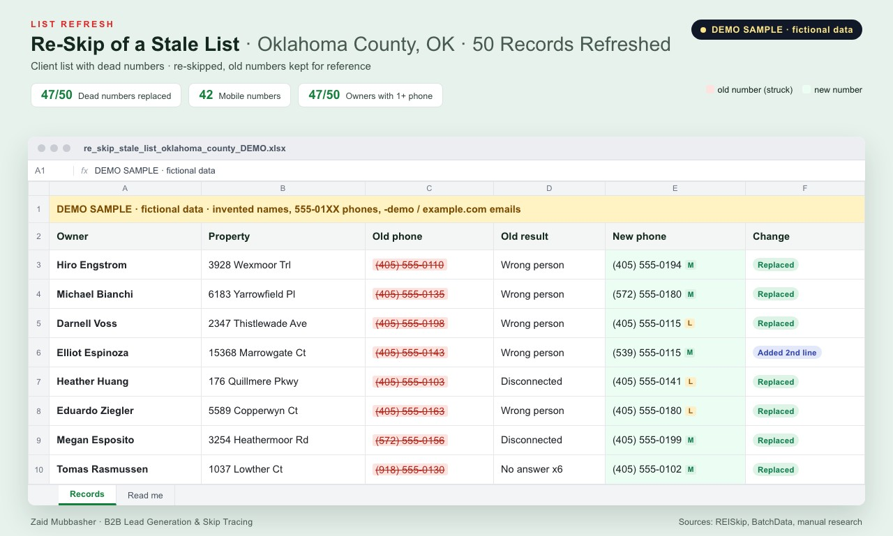 | **Re-Skip of a Stale List** Oklahoma County, OK · 50 Records Refreshed Client list with dead numbers · re-skipped, old numbers kept for reference | 50 | [CSV](skiptrace/19-re-skip-stale-list-oklahoma-county-ok/data.csv) · [XLSX](skiptrace/19-re-skip-stale-list-oklahoma-county-ok/data.xlsx) [square cover](skiptrace/19-re-skip-stale-list-oklahoma-county-ok/cover_square.jpg) |
| 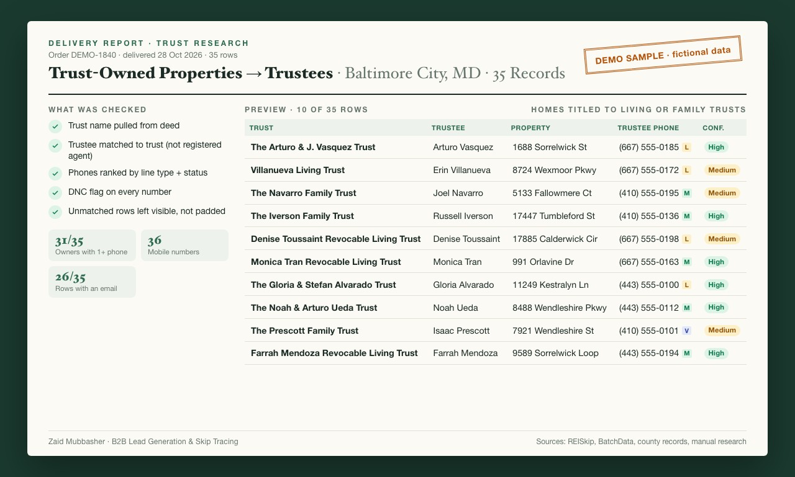 | **Trust-Owned Properties → Trustees** Baltimore City, MD · 35 Records Homes titled to living or family trusts · trustee identified and skip-traced | 35 | [CSV](skiptrace/20-trust-owned-properties-baltimore-md/data.csv) · [XLSX](skiptrace/20-trust-owned-properties-baltimore-md/data.xlsx) [square cover](skiptrace/20-trust-owned-properties-baltimore-md/cover_square.jpg) |
| 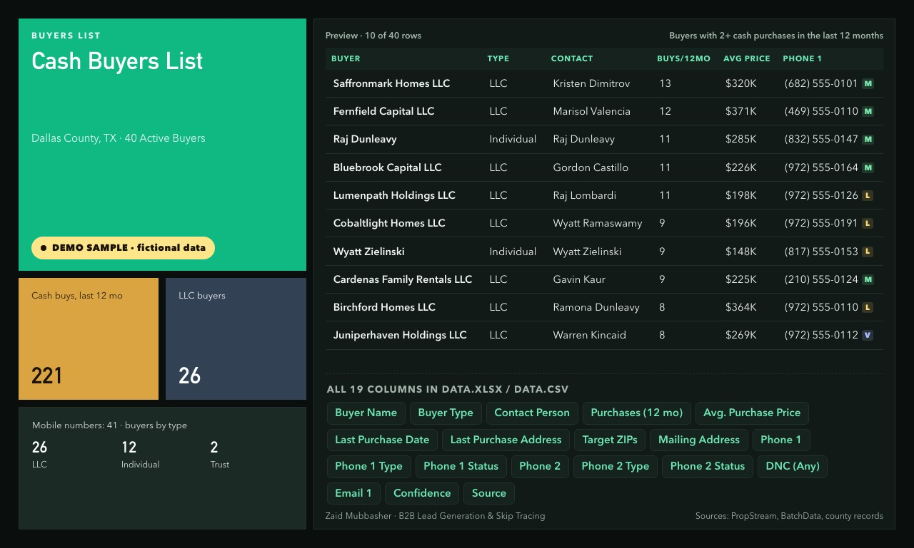 | **Cash Buyers List** Dallas County, TX · 40 Active Buyers Buyers with 2+ cash purchases in the last 12 months · contact person skip-traced | 40 | [CSV](skiptrace/21-cash-buyers-dallas-county-tx/data.csv) · [XLSX](skiptrace/21-cash-buyers-dallas-county-tx/data.xlsx) [square cover](skiptrace/21-cash-buyers-dallas-county-tx/cover_square.jpg) |
| 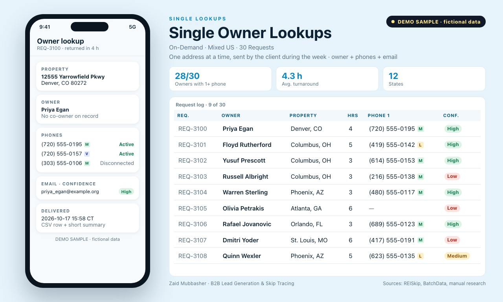 | **Single Owner Lookups** On-Demand · Mixed US · 30 Requests One address at a time, sent by the client during the week · owner + phones + email | 30 | [CSV](skiptrace/22-single-owner-lookups-on-demand/data.csv) · [XLSX](skiptrace/22-single-owner-lookups-on-demand/data.xlsx) [square cover](skiptrace/22-single-owner-lookups-on-demand/cover_square.jpg) |
| 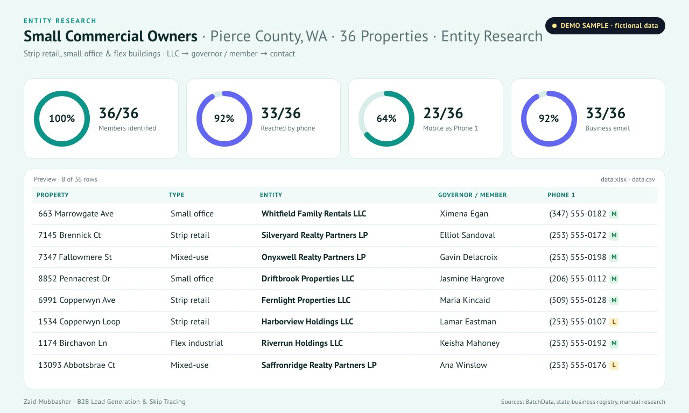 | **Small Commercial Owners** Pierce County, WA · 36 Properties · Entity Research Strip retail, small office &amp; flex buildings · LLC → governor / member → contact | 36 | [CSV](skiptrace/23-commercial-entity-owners-pierce-county-wa/data.csv) · [XLSX](skiptrace/23-commercial-entity-owners-pierce-county-wa/data.xlsx) [square cover](skiptrace/23-commercial-entity-owners-pierce-county-wa/cover_square.jpg) |
| 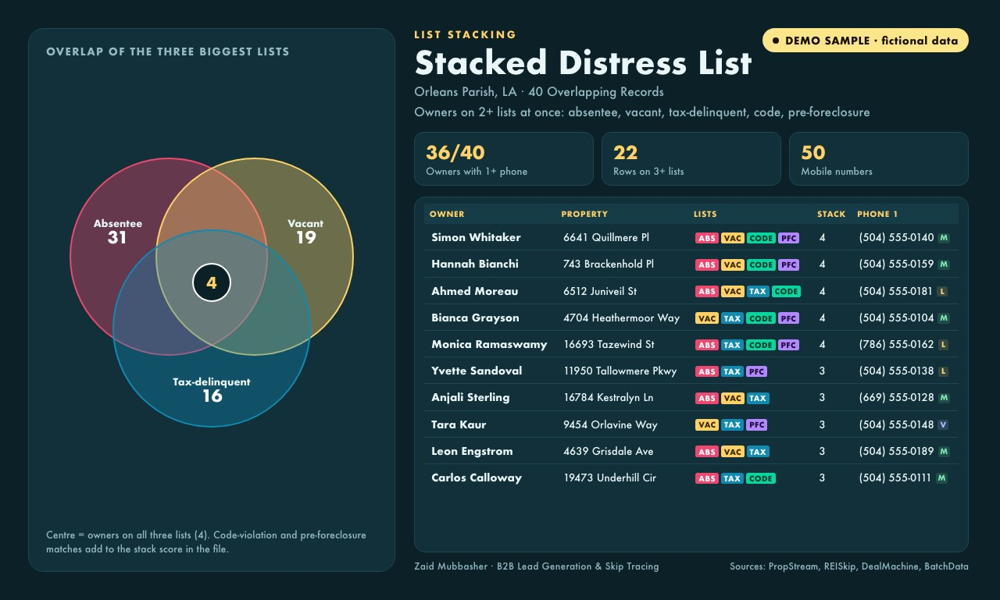 | **Stacked Distress List** Orleans Parish, LA · 40 Overlapping Records Owners on 2+ lists at once: absentee, vacant, tax-delinquent, code, pre-foreclosure | 40 | [CSV](skiptrace/24-stacked-distress-list-orleans-parish-la/data.csv) · [XLSX](skiptrace/24-stacked-distress-list-orleans-parish-la/data.xlsx) [square cover](skiptrace/24-stacked-distress-list-orleans-parish-la/cover_square.jpg) |

## How I work

- A free 10-lead sample before you commit
- Email verification before delivery
- The format you need: Excel, CSV, Google Sheets or a CRM import
- Quick replies during US business hours
- No duplicates. Catch-all emails are flagged and kept apart from verified ones, and rows with no match stay visible in the file. Nothing is padded.
- Dialer- and CRM-ready files for REsimpli, Podio, BatchDialer, Mojo and others

**Tools I have worked on:** PropStream, REISkip, DealMachine, BatchData, REsimpli, LeadSherpa, Apollo.io, Hunter.io, RocketReach, Lusha, LinkedIn.

Send me your target market (industry, location, company size and job titles, or your county and list type) and I'll put a sample together.

## Contact

**Zaid Mubbasher** · B2B Lead Generation & Skip Tracing
Email: [zmubbasher@gmail.com](mailto:zmubbasher@gmail.com)

---

DEMO SAMPLE · fictional data. Everything in this repository was created for portfolio purposes. Any resemblance to a real person, business or address is coincidental. Tool names are mentioned as plain text only and do not imply any affiliation.
